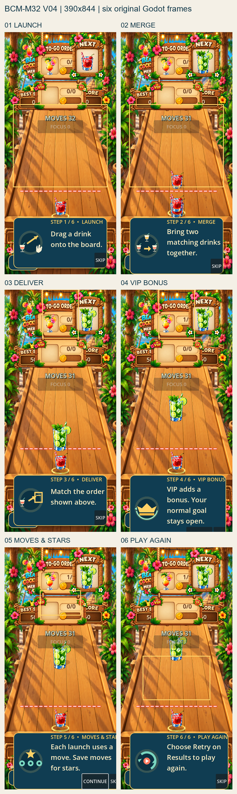
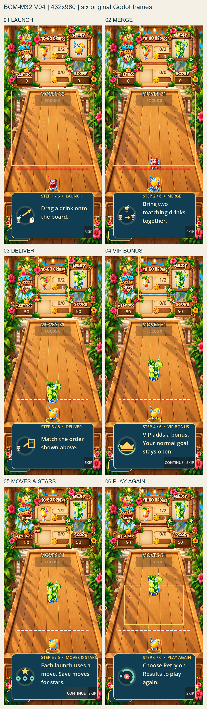

# BCM-M32 Tutorial V04 — Six-step graphical evidence

This package contains the six original frames captured from the production gameplay tutorial in Godot 4.7.2. The PNGs are full viewport captures at the listed dimensions; they were not cropped or composited. Contact sheets place the originals in a 2×3 grid at native pixel size so the small text remains readable.

## Runtime and source

- Godot: `4.7.2.stable.official.ed1daf0bf`.
- Renderer: OpenGL API 3.3.0 Compatibility; Intel Iris Xe Graphics.
- Production tutorial source commit: [`8050bd796c7aecd49b73c0a3123cdc5d30a3c36e`](https://github.com/Sekiph82/Beach-Cocktails-Merge/commit/8050bd796c7aecd49b73c0a3123cdc5d30a3c36e).
- Repository/evidence starting commit: [`0e79cfee71a0161965d1a66f43164eec1e3e5e48`](https://github.com/Sekiph82/Beach-Cocktails-Merge/commit/0e79cfee71a0161965d1a66f43164eec1e3e5e48). Tutorial production code was unchanged from the production source commit above.
- The two test projects were extracted from committed source into distinct `%LOCALAPPDATA%` folders with unique Godot application identities and separate `user://` storage. They do not use the owner Desktop project or its save data.
- Runtime tutorial `current_step` was never assigned by the capture harness. Stages 1, 2, and 3 followed the real shot, physics merge, and delivery paths. The Continue button was activated with mouse events when it fit inside the viewport; for the 390×844 VIP frame its rectangle was below the viewport, so a focused Enter key event activated the same production button.
- Reversible scenario setup: after the production campaign opened, the harness seeded one matching settled drink through `GameManager.spawn_drink` for the physical merge, then seeded one order-matching drink through the same production spawn method and invoked the normal stock-matching method. The production collection animation, session delivery record, and tutorial signal advanced the delivery stage. No gameplay physics, tutorial art, or production data files were edited.
- The test level’s one L5 order completes Sunny Cove level 1. The resulting production result panel remains visible over the tutorial in later frames; that overlap is preserved in the screenshots for owner review.
- `V03` evidence and its builder log remain unchanged. The owner review cells below are all `PENDING_OWNER`.

## Six-panel contact sheets

### 390 × 844

[Open the full-resolution six-panel contact sheet](contact_sheet_390x844.png)

### 432 × 960

[Open the full-resolution six-panel contact sheet](contact_sheet_432x960.png)

## Original frames — 390 × 844

| Step | Trigger and capture time (UTC) | Original PNG |
| --- | --- | --- |
| 01 LAUNCH | Fresh tutorial start; 2026-10-12 17:50:11 | [tutorial_01_launch.png](390x844/tutorial_01_launch.png) |
| 02 MERGE | Production ShotController release; `GameManager.on_shot_fired`; 17:50:12 | [tutorial_02_merge.png](390x844/tutorial_02_merge.png) |
| 03 DELIVER | Physical matching collision; `MergeQueue` → `GameManager.on_merged`; 17:50:12 | [tutorial_03_deliver.png](390x844/tutorial_03_deliver.png) |
| 04 VIP BONUS | Stocked target collection → session delivery signal; 17:50:12 | [tutorial_04_vip_bonus.png](390x844/tutorial_04_vip_bonus.png) |
| 05 MOVES & STARS | Focused production Continue button, Enter key (button bounds y=826.66–878.66 exceed viewport); 17:50:12 | [tutorial_05_moves_stars.png](390x844/tutorial_05_moves_stars.png) |
| 06 PLAY AGAIN | Production Continue button, mouse event; 17:50:12 | [tutorial_06_play_again.png](390x844/tutorial_06_play_again.png) |

Viewport dimensions were checked from each PNG: `390×844`.

## Original frames — 432 × 960

| Step | Trigger and capture time (UTC) | Original PNG |
| --- | --- | --- |
| 01 LAUNCH | Fresh tutorial start; 2026-10-12 17:50:21 | [tutorial_01_launch.png](432x960/tutorial_01_launch.png) |
| 02 MERGE | Production ShotController release; `GameManager.on_shot_fired`; 17:50:21 | [tutorial_02_merge.png](432x960/tutorial_02_merge.png) |
| 03 DELIVER | Physical matching collision; `MergeQueue` → `GameManager.on_merged`; 17:50:21 | [tutorial_03_deliver.png](432x960/tutorial_03_deliver.png) |
| 04 VIP BONUS | Stocked target collection → session delivery signal; 17:50:22 | [tutorial_04_vip_bonus.png](432x960/tutorial_04_vip_bonus.png) |
| 05 MOVES & STARS | Production Continue button, mouse event; 17:50:22 | [tutorial_05_moves_stars.png](432x960/tutorial_05_moves_stars.png) |
| 06 PLAY AGAIN | Production Continue button, mouse event; 17:50:22 | [tutorial_06_play_again.png](432x960/tutorial_06_play_again.png) |

Viewport dimensions were checked from each PNG: `432×960`.

## Builder visual observations — not acceptance

- **Tutorial drawings:** the drink/arrow/hand, merging drinks, delivery glass/box, crown, star/move markers, and retry loop/play mark are distinguishable in the full-resolution frames. Their relative scale looks consistent across the two captures.
- **Text fit:** all six short hints fit the card width. The VIP Continue control on 390×844 is clipped by the bottom edge: measured bounds `[x=229.2, y=826.66, w=91, h=52]` in a 844 px viewport. At 432×960 its measured bounds are `[x=257.56, y=881.4, w=91, h=52]` and fit within the viewport.
- **Result overlay and board:** the real Level Complete panel appears after the seeded L5 delivery. In MOVES & STARS and PLAY AGAIN it covers much of the tabletop and tutorial background. On the 432 px wide captures its heading/body text is cut at the right edge; the modal and tutorial card overlap.
- **Retry cue:** the PLAY AGAIN highlight rectangle covers the middle of the result panel body while the instruction says to choose Retry. The Retry action itself is not visible in the captured frame because the result action row is behind/under the tutorial card.
- **HUD/buttons:** top HUD text and drink thumbnails are visible in the original frames. At the bottom-left, the Pause control is partly behind the tutorial card. The narrow 390 px layout clips the VIP Continue button; the 432 px frames show both Continue and Skip, with their controls crowded against the card’s right edge.
- No artwork, tutorial layout, labels, controls, HUD, or runtime code was changed for this evidence task. These observations do not rate aesthetics or approve the tutorial.

## Runtime log summary

Both graphical runs exited with code `0`; each emitted all six `V04_CAPTURE` records and `V04_SEQUENCE_COMPLETE six_steps=6 direct_current_step_mutation=false`. The renderer and version matched the values above. Startup emitted two known invalid-UID fallback warnings for `WorldMapScene.tscn` and `main.tscn`; neither blocked launch or capture. No second-resolution frames are missing.

See `docs/codex-logs/CODEX_LOG_M32_OWNER_TUTORIAL_V04_VISUAL_EVIDENCE.md` for execution and repository evidence.
