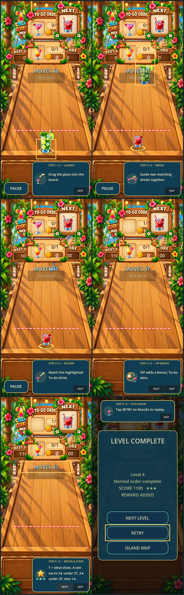
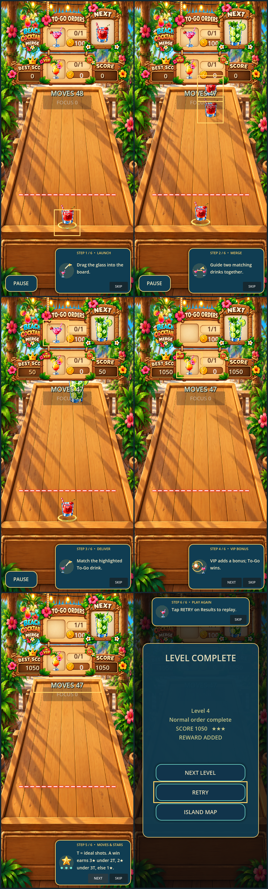

# BCM-M32 Tutorial V05 visual remediation evidence

**Status:** awaiting independent GPT audit and explicit owner visual review. No screen is marked approved.

## Review contact sheets

390 × 844, in order: LAUNCH, MERGE, DELIVER, VIP BONUS, MOVES & STARS, PLAY AGAIN.

432 × 960, same order.

## Original graphical captures

Each PNG below is an uncropped, unmodified frame captured from the production Godot runtime. The contact sheets are simple 2-column × 3-row presentations of those originals.

### 390 × 844

- [Step 1 — Launch](390x844/tutorial_01_launch.png)
- [Step 2 — Merge](390x844/tutorial_02_merge.png)
- [Step 3 — Deliver](390x844/tutorial_03_deliver.png)
- [Step 4 — VIP Bonus](390x844/tutorial_04_vip_bonus.png)
- [Step 5 — Moves & Stars](390x844/tutorial_05_moves_stars.png)
- [Step 6 — Play Again](390x844/tutorial_06_play_again.png)
- [Production interaction trace](390x844/tutorial_interaction_trace.txt)

### 432 × 960

- [Step 1 — Launch](432x960/tutorial_01_launch.png)
- [Step 2 — Merge](432x960/tutorial_02_merge.png)
- [Step 3 — Deliver](432x960/tutorial_03_deliver.png)
- [Step 4 — VIP Bonus](432x960/tutorial_04_vip_bonus.png)
- [Step 5 — Moves & Stars](432x960/tutorial_05_moves_stars.png)
- [Step 6 — Play Again](432x960/tutorial_06_play_again.png)
- [Production interaction trace](432x960/tutorial_interaction_trace.txt)

## Capture details

- Godot 4.7.2.stable.official.ed1daf0bf, Intel Iris Xe Graphics.
- Production-path input and tutorial hooks were exercised in isolated project identities, one for each resolution.
- Disposable test save unlocks Levels 1–3 to expose the live Level 4 VIP HUD. The tutorial itself starts at production Level 4 with an actual To-Go L6 and optional VIP L5. A test-only L6 is delivered through the production target capture/tween, order recorder, and tutorial delivery hook.
- LAUNCH uses a real held drink drag/release; MERGE uses two actual same-level drinks and production physics/GameManager merge event; VIP continues without delivering VIP; PLAY AGAIN displays the actual Results popup and clicks its real RETRY callback.
- The distinct app identities isolate `user://` writes from the owner save. No owner save was modified.
- Both runs reported `TUTORIAL_V05_CAPTURE_RESULT=PASS`. RETRY control bounds are on-screen at both viewport sizes; see traces.
- Individual source frames were copied byte-for-byte. Only contact sheets combine pixels for review.
- Builder evidence is not visual acceptance. Awaiting GPT audit and owner review.

## Owner review

See [OWNER_FEEDBACK.md](OWNER_FEEDBACK.md). All six review cells remain `PENDING_OWNER`.

## Required stop marker

`AWAITING_GPT_AND_OWNER_TUTORIAL_V05_VISUAL_REVIEW`
