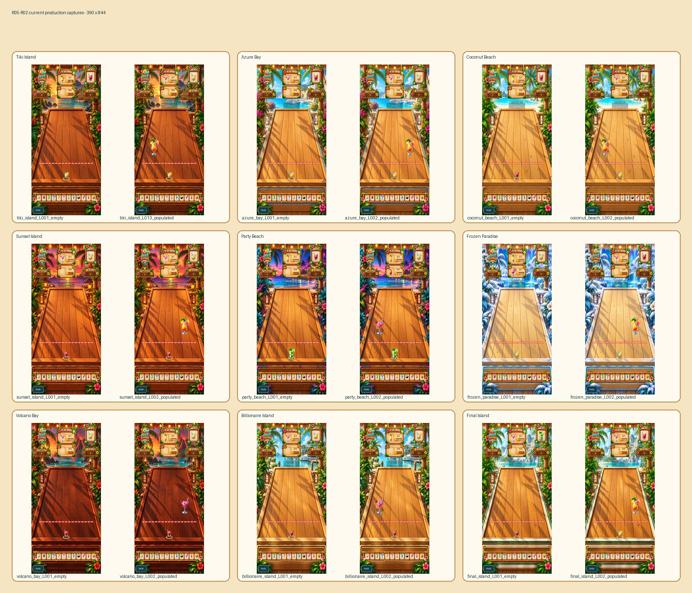
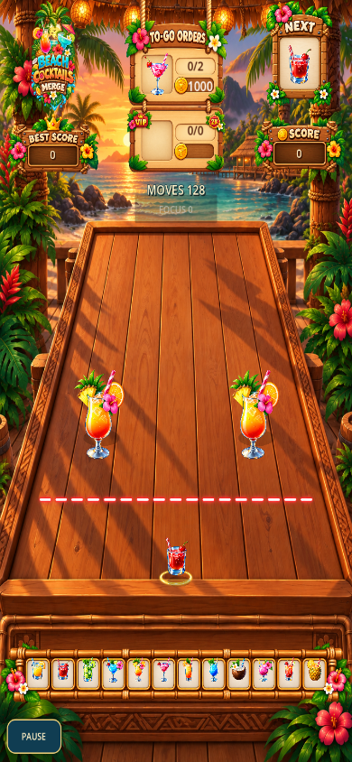

# BCM-M33-R05-R02 visual review index

Builder evidence only. Awaiting independent GPT and owner visual review.

## Galleries

## Tiki one-starter and two-starter contrast

### 390 x 844

### 432 x 960

## Same-level L6 scale comparison

- [Godot frame (390 x 844)](comparison/same_level_390x844.png) - [telemetry](comparison/same_level_390x844.json)
- [Godot frame (432 x 960)](comparison/same_level_432x960.png) - [telemetry](comparison/same_level_432x960.json)

## Full-resolution original captures

### 390 x 844

- [azure_bay_L001_empty.png](screenshots/390x844/azure_bay_L001_empty.png) — SHA-256 `9EF6F6D8289884B695FC6338315C8C75ACA70C5C9391C702C31237867D671883`
- [azure_bay_L002_populated.png](screenshots/390x844/azure_bay_L002_populated.png) — SHA-256 `EB3EB8381AB48A6CE23CD96B2F2DE1F237B63E8A693BD7C7552A68D4E4C835E8`
- [billionaire_island_L001_empty.png](screenshots/390x844/billionaire_island_L001_empty.png) — SHA-256 `7C8A3FC564A7550CCBFEAB675D45F8C483AB07BD740AE07F352C265EE2E6A57A`
- [billionaire_island_L002_populated.png](screenshots/390x844/billionaire_island_L002_populated.png) — SHA-256 `0797A883001DE75E563AD02E4A3540A95B08561F4E4C9EA1C2D432247565E429`
- [coconut_beach_L001_empty.png](screenshots/390x844/coconut_beach_L001_empty.png) — SHA-256 `0C62921D5560063B48032F38CC19DB0FDD5A6C6B7070074FCD584E58C50BA82C`
- [coconut_beach_L002_populated.png](screenshots/390x844/coconut_beach_L002_populated.png) — SHA-256 `D6953FD739547645A56FE02EF1639ADC25129173F7EC10F0A1DD6B2D7B38A743`
- [final_island_L001_empty.png](screenshots/390x844/final_island_L001_empty.png) — SHA-256 `A3AD5AF7961E857F3842CD799A5A3573BEF5781C47721387330013424DF7B392`
- [final_island_L002_populated.png](screenshots/390x844/final_island_L002_populated.png) — SHA-256 `6AEADE5489D500E82446FED8A8FE4177D8B5D8EC1D932C56FAD0BD4BE0A44343`
- [frozen_paradise_L001_empty.png](screenshots/390x844/frozen_paradise_L001_empty.png) — SHA-256 `D96A6A3790339FC2A7E0ACD4192E99C009FF0FC84C328FE2676E297336F2F6D8`
- [frozen_paradise_L002_populated.png](screenshots/390x844/frozen_paradise_L002_populated.png) — SHA-256 `9C0A1C75071B8E355F4DFAF68CEFEF63643E8FBD38910715B4BD62C156E4ED20`
- [party_beach_L001_empty.png](screenshots/390x844/party_beach_L001_empty.png) — SHA-256 `C550C085B5D80BC2D5EE2CEF79033927709E3F82E96E36EA86D936237F1FA19D`
- [party_beach_L002_populated.png](screenshots/390x844/party_beach_L002_populated.png) — SHA-256 `58A7CD5CBB8AEFA0ECFDA177E133FF7DD2F3557F2B13978A9A6D23A0C55BD8AC`
- [sunset_island_L001_empty.png](screenshots/390x844/sunset_island_L001_empty.png) — SHA-256 `51696B0C43C425E92959E4BD456BF32F672B9509220656535A5DA08526DE94A3`
- [sunset_island_L002_populated.png](screenshots/390x844/sunset_island_L002_populated.png) — SHA-256 `8FBB95B42394D909784DF129194C862823321F7E78779024B191A8D1FF98CEC0`
- [tiki_island_L001_empty.png](screenshots/390x844/tiki_island_L001_empty.png) — SHA-256 `5107C264A4762CD767907F6C90E9FA36024AA1FC1E85F46134567F79BA471D02`
- [tiki_island_L013_populated.png](screenshots/390x844/tiki_island_L013_populated.png) — SHA-256 `C6429B828F5C8B5BA63DD4B8B0128E8224C560B8F21E60D44D7966282B787E51`
- [tiki_island_L027_contrast_two_drinks.png](screenshots/390x844/tiki_island_L027_contrast_two_drinks.png) — SHA-256 `A293F797EBFF915C227B56F9688446263D2A5E09ADC1C5A06C1C6256E431B379`
- [volcano_bay_L001_empty.png](screenshots/390x844/volcano_bay_L001_empty.png) — SHA-256 `F41FCBF2C43A9E665DB59734178F2FDB7E26E1361EF43E7D3F84F0C05656F0FE`
- [volcano_bay_L002_populated.png](screenshots/390x844/volcano_bay_L002_populated.png) — SHA-256 `0948229A7C74BF2CF216F590A095E1BE585A982BA977F65B8240BFF425F33FE3`

### 432 x 960

- [azure_bay_L001_empty.png](screenshots/432x960/azure_bay_L001_empty.png) — SHA-256 `4D9E98AADF43F70AD3473DF887758A62DB2E5855320E2EB56CE9426A6DC104F4`
- [azure_bay_L002_populated.png](screenshots/432x960/azure_bay_L002_populated.png) — SHA-256 `02CC6AAD2A086541AF0DDD3E567F5B2D6582B35CF901F1F4392A22F80592F05E`
- [billionaire_island_L001_empty.png](screenshots/432x960/billionaire_island_L001_empty.png) — SHA-256 `5C6CD59AEEFF5E515FDC330C4B77C6E302609A1B20A2ED934952A14B28B2B750`
- [billionaire_island_L002_populated.png](screenshots/432x960/billionaire_island_L002_populated.png) — SHA-256 `3F43BFF4A05B087F7BA6CD9AFA18DF4D48D1ABA5F750416D650415616E1BFDFD`
- [coconut_beach_L001_empty.png](screenshots/432x960/coconut_beach_L001_empty.png) — SHA-256 `FC7B62AEC712345EA4E90D85E7E628556317493C5FECB86BE6A1B6895805A68D`
- [coconut_beach_L002_populated.png](screenshots/432x960/coconut_beach_L002_populated.png) — SHA-256 `13497B6B240EF8F84402DCE379B8E6C5CE09DEA5FA3339FD5DDD4CAA6553421B`
- [final_island_L001_empty.png](screenshots/432x960/final_island_L001_empty.png) — SHA-256 `49CD3CB18C510FD4B42A1CAF177BC4F5CADAA40E483409A11A1F71F48B663F01`
- [final_island_L002_populated.png](screenshots/432x960/final_island_L002_populated.png) — SHA-256 `E348EB7A8CB2BFE63C5C8A4DA52233BA8187507544CDCFCD5FDCDF43A9B7053F`
- [frozen_paradise_L001_empty.png](screenshots/432x960/frozen_paradise_L001_empty.png) — SHA-256 `D1CF22A914A190745C9D88BA494263729981AC73FDFDA376F8E72BBF80E4811B`
- [frozen_paradise_L002_populated.png](screenshots/432x960/frozen_paradise_L002_populated.png) — SHA-256 `6641065923FA625097CEE86CE4A80BD69743C3C20B33D868B3D11D5EFE23FF05`
- [party_beach_L001_empty.png](screenshots/432x960/party_beach_L001_empty.png) — SHA-256 `F937A45A6E985353BF58EFB4E22CC7B6DD7FE947F4C812CD466D85E92B774A16`
- [party_beach_L002_populated.png](screenshots/432x960/party_beach_L002_populated.png) — SHA-256 `837D5332BBDB9DA5BC3A3448059B71700F79256D09DF13434D490711024EDC74`
- [sunset_island_L001_empty.png](screenshots/432x960/sunset_island_L001_empty.png) — SHA-256 `423A59458A5A287A6CF7B8F8249C6DED02E0D6B0DAF32206F0BB1A515824A2CA`
- [sunset_island_L002_populated.png](screenshots/432x960/sunset_island_L002_populated.png) — SHA-256 `6347CB84B2F3E1719EAF9E2910EF5DFA8AD7BE136E8246B6BAA890B0A56E1129`
- [tiki_island_L001_empty.png](screenshots/432x960/tiki_island_L001_empty.png) — SHA-256 `C2D84463C8E9DBF5D7A86E7E66F5E53F444E278E6161D47F7307610A8021D4B6`
- [tiki_island_L013_populated.png](screenshots/432x960/tiki_island_L013_populated.png) — SHA-256 `C1992772C7D23EBA128E53A50C2D85C2C8809138970A1037B87AF415BB60FCA9`
- [tiki_island_L027_contrast_two_drinks.png](screenshots/432x960/tiki_island_L027_contrast_two_drinks.png) — SHA-256 `2DEC976D1C614C0F2E7A30086CCC59544616A94DA26A491E730D72685237066B`
- [volcano_bay_L001_empty.png](screenshots/432x960/volcano_bay_L001_empty.png) — SHA-256 `B5FD434CED7B0D4E605BB139D7DEED6A5E3EC95901710AAF7DB7ED1020A6D461`
- [volcano_bay_L002_populated.png](screenshots/432x960/volcano_bay_L002_populated.png) — SHA-256 `19533C8BADD713708CA206E336027F5B91EB0E4878F38DF72C4B70E3AB4894DF`

## Manifests and boundaries

- [390×844 Godot capture manifest](screenshots/capture_manifest_390x844.json)
- [432×960 Godot capture manifest](screenshots/capture_manifest_432x960.json)
- [Screenshot SHA-256 manifest](screenshot_sha256_manifest.json)
- [Preplaced starter tier distribution](starter_level_distribution.json)
- [Generation report](generation_report.json)

Current generated campaign contains L5 and L6 preplaced starters; no L7 or L8 starter entries exist to compare. The direct same-level production comparison covers an actual L6 starter at Azure Bay L8. Original capture PNGs are linked unchanged; galleries are derived overview images.

Stop marker: `AWAITING_GPT_AND_OWNER_R05_R02_VISUAL_REVIEW`
