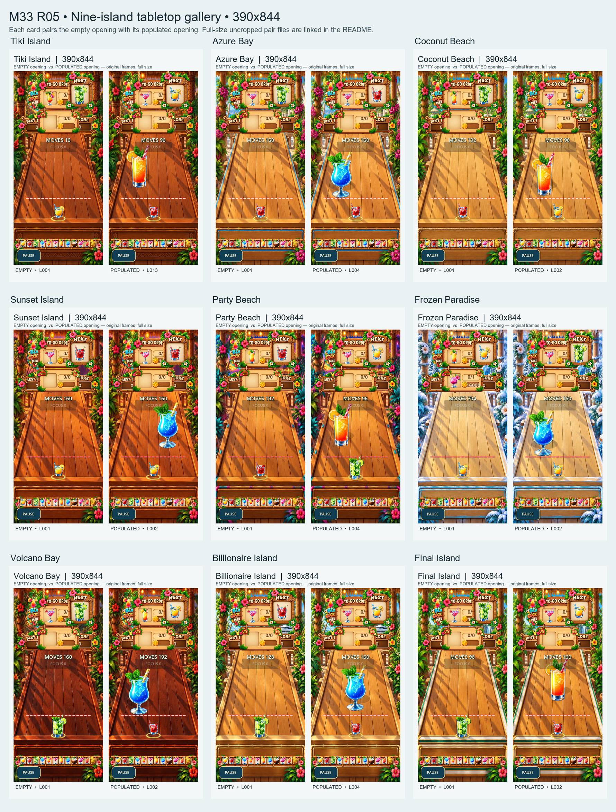

# BCM-M33 R05 Builder Evidence

Status: `AWAITING_GPT_M33_R05_INDEPENDENT_AUDIT_AND_OWNER_TABLETOP_REVIEW`

This package records builder evidence for the owner-approved controlled-repeat and initial-tabletop variation. It does not claim independent acceptance, human playability, or mobile-device QA.

## Findings

- **R05-001 — Runtime and schema:** optional per-level `initial_tabletop_drinks_version: 1` and `initial_tabletop_drinks: []` records are backward-compatible; legacy records without either field load as an empty inventory. Version 1 requires an array of real cocktail levels and normalized positions. Validation checks goal compatibility (direct normal target or one level below a normal target), bounds, quantity, collision spacing, and VIP exclusion. Runtime placement uses production `Drink` nodes and the accepted R04 playable-surface projection.
- **R05-002 — Content:** regenerated only 888 generated records. The 100 Sunny Cove records and original M32 Tiki seed file remained unchanged; Tiki L1-L12 gameplay payload is preserved in the packaged file. Ordinary objectives use L6-L8 and normal T is at most 56. Nine local-level-100 L9 capstones remain above T56. The existing 4T move limit, star formula, optional VIP, rewards, level identities, campaign size, and no-timer policy remain in place.
- **R05-003 — Starting inventory:** every generated record has explicit schema version 1; designated empty openings are empty. Populated entries match a normal target or provide one L3-L8 merge step toward a normal target. Inventory cannot satisfy all normal order quantity, cannot equal the optional VIP level, and starts in the central tabletop safe area above the danger/launch lane. Retry respawns the same placement; pause/resume retains the same in-session nodes.
- **R05-004 — Verification:** deterministic generator/static validator, Godot full-content probe, production-scene tabletop probe, navigation/save probe, and focused session bridge regression were run in the isolated Codex sandbox. A bounded production-physics merge of a real moving L6 with preplaced L6 created L7 and the To-Go flow delivered that result. A directly compatible preplaced L6 was delivered with zero moves used and without terminal completion.
- **R05-005 — Owner review:** visual review and independent audit are pending. No approval is claimed from builder screenshots or automated probes.

## Controlled-repeat counts

See `controlled_repetition_and_hash_report.json` for exact nine-island before/after difficulty and repetition counts, adjacent and nearby-window counts, and SHA-256 values. It compares the synchronized R04 package at base commit `c62be113dd93adf5fe7c9e96627036cf74411286` with the R05 generator output. `nine_island_before_after_difficulty_and_repetition.csv` provides the same island metrics in tabular form.

For the 888 generated records, R05 records 718 within-island repeated normal objectives and 603 within-island repeated full recipes. Cross-island duplicate occurrences are 145 for normal objectives and 209 for full recipes. There are 71 adjacent identical full recipes, while adjacent identical recipe-plus-tabletop layouts are 0. Across the previous 5/10 records there are 310/569 repeated full-recipe pairs and 0/25 repeated recipe-plus-layout pairs.

`sample_36_recipes_and_tabletop_layouts.csv` contains four generated samples per island (the entry opening, mid/late samples, and capstone) with objectives, normal T, VIP, unchanged 4T budget, schema version, and initial drink positions.

## Godot captures

`screenshots/` contains 38 active PNGs captured directly from the production gameplay scene running in Godot 4.7.2 on the Intel Iris Xe OpenGL compatibility renderer. Each of the nine generated islands has an empty opening and a populated opening at 390×844 and 432×960. Each size also has a two-drink Tiki contrast. The capture script saved the Godot viewport image directly; the PNGs were not composited or resized after capture. See `capture_manifest.json` for the active inventory and file hashes.

Nine PNGs from an earlier capture pass are also present and individually listed under `superseded_artifacts` in the manifest. Their positions predate the final safe-area correction, so they are excluded from the active review set. The app safety review rejected their removal; the files are retained and marked so they are not confused with the final captures.

Suggested owner review:

1. Compare each island's `*_empty.png` and `*_populated.png` pair at both resolutions. Confirm the drink is visible on the playable tabletop and clear of HUD, shelf, danger line, and launch lane.
2. Review `tiki_island_L027_contrast_two_drinks.png` at both resolutions for spacing and readability with two starters.
3. Review the corresponding row in `sample_36_recipes_and_tabletop_layouts.csv` and decide whether each shown starting stock is a suitable match or merge lead for its listed normal orders.
4. Return any per-island or per-level visual/gameplay corrections. Builder screenshots are review material, not owner acceptance.

## Hashes

Authoritative generated-file and manifest hashes are recorded in `controlled_repetition_and_hash_report.json`. Protected source checks remain:

- Sunny Cove level source: `573B5CA14CA75BEC04F40A5B7D00AA441534A266569B200E36E78B28D3591128`.
- Original M32 Tiki seed: `AD4AE20C26D482082E9FFD170CC5E66DDE895403FE5E6D260A5BEEC8CFFBFF53`.

<!-- OWNER_VISUAL_CONTACT_SHEETS_R01_BEGIN -->

## Owner visual contact sheets — R05-R01

Status: `AWAITING_GPT_AND_OWNER_M33_R05_VISUAL_REVIEW`. These are review aids built only from the 38 active original PNGs in `screenshots/capture_manifest.json`. The nine superseded captures were excluded and left untouched. No gameplay source or screenshot pixels were retouched. Individual pair PNGs place the original frames uncropped at native dimensions; overview thumbnails are scaled proportionally for the grid.

### Nine-island overview galleries

**390x844** — [open full-size gallery](owner_visual_contact_sheets_r01/nine_island_gallery_390x844.png)

**432x960** — [open full-size gallery](owner_visual_contact_sheets_r01/nine_island_gallery_432x960.png)

### Island pairs and representative level details

The populated screenshot's local level ID selects the live level JSON row. Normal T is `theoretical_shots_total`; positions are the normalized `initial_tabletop_drinks` coordinates. Each original frame is linked separately.

#### Tiki Island

- **390x844:** [EMPTY vs POPULATED pair](owner_visual_contact_sheets_r01/pairs/390x844/tiki_island.png) · [empty original, L001](screenshots/390x844/tiki_island_L001_empty.png) · [populated original, L013](screenshots/390x844/tiki_island_L013_populated.png)
- **432x960:** [EMPTY vs POPULATED pair](owner_visual_contact_sheets_r01/pairs/432x960/tiki_island.png) · [empty original, L001](screenshots/432x960/tiki_island_L001_empty.png) · [populated original, L013](screenshots/432x960/tiki_island_L013_populated.png)
- **Representative populated level facts:** L013: To-Go L6 × 1, L7 × 1; VIP none; normal T 24; starter: L7 at (0.34, 0.52) — direct order stock. [current level JSON](../../../../../data/campaign/levels/tiki_island_full.json)

#### Azure Bay

- **390x844:** [EMPTY vs POPULATED pair](owner_visual_contact_sheets_r01/pairs/390x844/azure_bay.png) · [empty original, L001](screenshots/390x844/azure_bay_L001_empty.png) · [populated original, L004](screenshots/390x844/azure_bay_L004_populated.png)
- **432x960:** [EMPTY vs POPULATED pair](owner_visual_contact_sheets_r01/pairs/432x960/azure_bay.png) · [empty original, L001](screenshots/432x960/azure_bay_L001_empty.png) · [populated original, L004](screenshots/432x960/azure_bay_L004_populated.png)
- **Representative populated level facts:** L004: To-Go L6 × 1, L8 × 1; VIP none; normal T 40; starter: L8 at (0.34, 0.56) — direct order stock. [current level JSON](../../../../../data/campaign/levels/azure_bay.json)

#### Coconut Beach

- **390x844:** [EMPTY vs POPULATED pair](owner_visual_contact_sheets_r01/pairs/390x844/coconut_beach.png) · [empty original, L001](screenshots/390x844/coconut_beach_L001_empty.png) · [populated original, L002](screenshots/390x844/coconut_beach_L002_populated.png)
- **432x960:** [EMPTY vs POPULATED pair](owner_visual_contact_sheets_r01/pairs/432x960/coconut_beach.png) · [empty original, L001](screenshots/432x960/coconut_beach_L001_empty.png) · [populated original, L002](screenshots/432x960/coconut_beach_L002_populated.png)
- **Representative populated level facts:** L002: To-Go L7 × 1, L6 × 1; VIP none; normal T 24; starter: L7 at (0.35, 0.56) — direct order stock. [current level JSON](../../../../../data/campaign/levels/coconut_beach.json)

#### Sunset Island

- **390x844:** [EMPTY vs POPULATED pair](owner_visual_contact_sheets_r01/pairs/390x844/sunset_island.png) · [empty original, L001](screenshots/390x844/sunset_island_L001_empty.png) · [populated original, L002](screenshots/390x844/sunset_island_L002_populated.png)
- **432x960:** [EMPTY vs POPULATED pair](owner_visual_contact_sheets_r01/pairs/432x960/sunset_island.png) · [empty original, L001](screenshots/432x960/sunset_island_L001_empty.png) · [populated original, L002](screenshots/432x960/sunset_island_L002_populated.png)
- **Representative populated level facts:** L002: To-Go L6 × 1, L8 × 1; VIP none; normal T 40; starter: L8 at (0.66, 0.52) — direct order stock. [current level JSON](../../../../../data/campaign/levels/sunset_island.json)

#### Party Beach

- **390x844:** [EMPTY vs POPULATED pair](owner_visual_contact_sheets_r01/pairs/390x844/party_beach.png) · [empty original, L001](screenshots/390x844/party_beach_L001_empty.png) · [populated original, L004](screenshots/390x844/party_beach_L004_populated.png)
- **432x960:** [EMPTY vs POPULATED pair](owner_visual_contact_sheets_r01/pairs/432x960/party_beach.png) · [empty original, L001](screenshots/432x960/party_beach_L001_empty.png) · [populated original, L004](screenshots/432x960/party_beach_L004_populated.png)
- **Representative populated level facts:** L004: To-Go L6 × 1, L7 × 1; VIP none; normal T 24; starter: L7 at (0.34, 0.52) — direct order stock. [current level JSON](../../../../../data/campaign/levels/party_beach.json)

#### Frozen Paradise

- **390x844:** [EMPTY vs POPULATED pair](owner_visual_contact_sheets_r01/pairs/390x844/frozen_paradise.png) · [empty original, L001](screenshots/390x844/frozen_paradise_L001_empty.png) · [populated original, L002](screenshots/390x844/frozen_paradise_L002_populated.png)
- **432x960:** [EMPTY vs POPULATED pair](owner_visual_contact_sheets_r01/pairs/432x960/frozen_paradise.png) · [empty original, L001](screenshots/432x960/frozen_paradise_L001_empty.png) · [populated original, L002](screenshots/432x960/frozen_paradise_L002_populated.png)
- **Representative populated level facts:** L002: To-Go L8 × 1, L6 × 1; VIP none; normal T 40; starter: L8 at (0.34, 0.56) — direct order stock. [current level JSON](../../../../../data/campaign/levels/frozen_paradise.json)

#### Volcano Bay

- **390x844:** [EMPTY vs POPULATED pair](owner_visual_contact_sheets_r01/pairs/390x844/volcano_bay.png) · [empty original, L001](screenshots/390x844/volcano_bay_L001_empty.png) · [populated original, L002](screenshots/390x844/volcano_bay_L002_populated.png)
- **432x960:** [EMPTY vs POPULATED pair](owner_visual_contact_sheets_r01/pairs/432x960/volcano_bay.png) · [empty original, L001](screenshots/432x960/volcano_bay_L001_empty.png) · [populated original, L002](screenshots/432x960/volcano_bay_L002_populated.png)
- **Representative populated level facts:** L002: To-Go L8 × 1, L7 × 1; VIP none; normal T 48; starter: L8 at (0.34, 0.56) — direct order stock. [current level JSON](../../../../../data/campaign/levels/volcano_bay.json)

#### Billionaire Island

- **390x844:** [EMPTY vs POPULATED pair](owner_visual_contact_sheets_r01/pairs/390x844/billionaire_island.png) · [empty original, L001](screenshots/390x844/billionaire_island_L001_empty.png) · [populated original, L004](screenshots/390x844/billionaire_island_L004_populated.png)
- **432x960:** [EMPTY vs POPULATED pair](owner_visual_contact_sheets_r01/pairs/432x960/billionaire_island.png) · [empty original, L001](screenshots/432x960/billionaire_island_L001_empty.png) · [populated original, L004](screenshots/432x960/billionaire_island_L004_populated.png)
- **Representative populated level facts:** L004: To-Go L8 × 1, L6 × 1; VIP none; normal T 40; starter: L8 at (0.50, 0.54) — direct order stock. [current level JSON](../../../../../data/campaign/levels/billionaire_island.json)

#### Final Island

- **390x844:** [EMPTY vs POPULATED pair](owner_visual_contact_sheets_r01/pairs/390x844/final_island.png) · [empty original, L001](screenshots/390x844/final_island_L001_empty.png) · [populated original, L002](screenshots/390x844/final_island_L002_populated.png)
- **432x960:** [EMPTY vs POPULATED pair](owner_visual_contact_sheets_r01/pairs/432x960/final_island.png) · [empty original, L001](screenshots/432x960/final_island_L001_empty.png) · [populated original, L002](screenshots/432x960/final_island_L002_populated.png)
- **Representative populated level facts:** L002: To-Go L8 × 1, L6 × 1; VIP none; normal T 40; starter: L7 at (0.50, 0.50) — one-level merge precursor. [current level JSON](../../../../../data/campaign/levels/final_island.json)

### Tiki two-starter contrast

These compare different Tiki levels, so they show one-versus-two starter density rather than a controlled same-level before/after. The displayed objective/position facts are read from each level JSON row.

**390x844:** [one vs two starters](owner_visual_contact_sheets_r01/tiki_contrast/tiki_390x844.png) · [one-starter original](screenshots/390x844/tiki_island_L013_populated.png) · [two-starter original](screenshots/390x844/tiki_island_L027_contrast_two_drinks.png)

- One starter: L013: To-Go L6 × 1, L7 × 1; VIP none; normal T 24; starter: L7 at (0.34, 0.52) — direct order stock.
- Two starters: L027: To-Go L6 × 2, L7 × 1; VIP none; normal T 32; starter: L6 at (0.33, 0.54) — direct order stock; L7 at (0.67, 0.54) — direct order stock.

**432x960:** [one vs two starters](owner_visual_contact_sheets_r01/tiki_contrast/tiki_432x960.png) · [one-starter original](screenshots/432x960/tiki_island_L013_populated.png) · [two-starter original](screenshots/432x960/tiki_island_L027_contrast_two_drinks.png)

- One starter: L013: To-Go L6 × 1, L7 × 1; VIP none; normal T 24; starter: L7 at (0.34, 0.52) — direct order stock.
- Two starters: L027: To-Go L6 × 2, L7 × 1; VIP none; normal T 32; starter: L6 at (0.33, 0.54) — direct order stock; L7 at (0.67, 0.54) — direct order stock.

### Builder visual observations

- In the inspected populated frames, starter glass art and its floor shadow are visible against the tabletop. The starters sit in the central playable area and do not visibly cross the dashed danger boundary; several of the larger single glasses end close to it, so clearance needs owner review. The held launch drink remains lower in the launch lane, and the visible HUD/order shelf remain above the starters.
- Starter glass art occupies a substantial tabletop footprint, especially in the Tiki two-starter contrast. The two Tiki drinks are separated horizontally and remain visibly above the danger boundary in the captured frames.
- Static screenshots show no starter occluding the HUD, shelf, danger marker, launch drink, or another starter in the inspected captures. Actual touch/mouse hit-target behavior cannot be established from still images and remains for owner/runtime review.
- Theme lighting and tabletop grain/shadows vary by island. These observations are builder inspection only; none of the visuals are labeled owner-approved.

### Owner review checklist

Please reply briefly for each item (yes/no plus any island or level ID):

1. Are the starter cocktails clearly visible and at a suitable scale on each island?
2. Are their positions safely clear of the HUD, order shelf, danger boundary, and launch lane?
3. Is the two-starter Tiki layout readable and comfortably spaced?
4. Do the representative starters feel like useful direct order stock or merge precursors for their displayed orders?
5. Which island/level layouts should change before visual approval?

No owner visual approval is claimed. Human playability, physical-device review, and independent follow-up remain separate gates.
<!-- OWNER_VISUAL_CONTACT_SHEETS_R01_END -->
